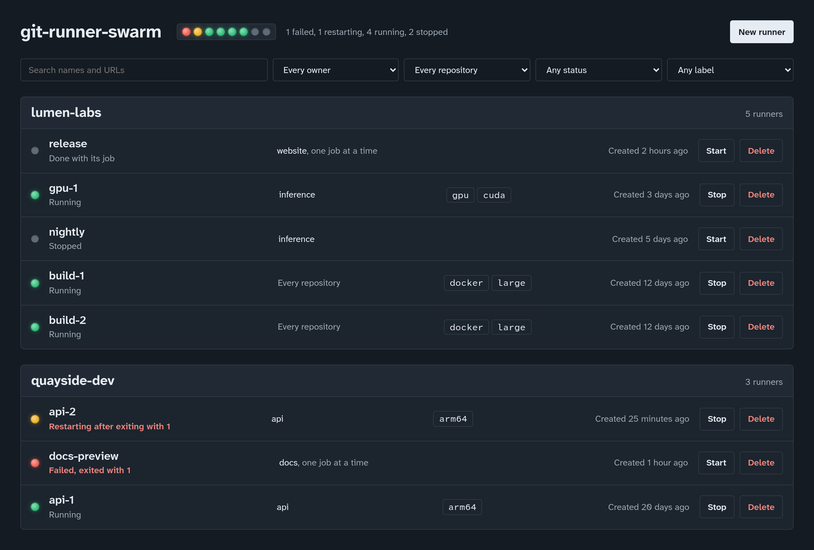
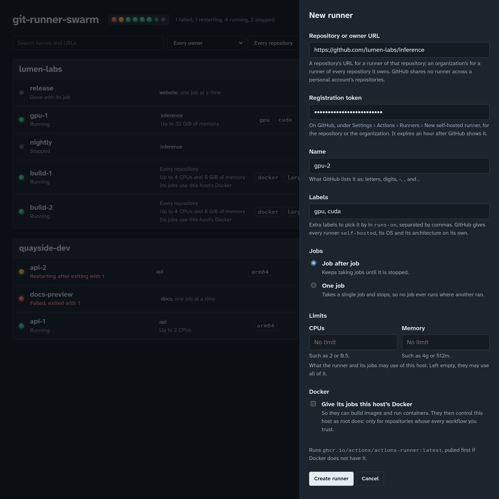

# git-runner-swarm

A web panel for self-hosted GitHub Actions runners. Each runner is a
Docker container running GitHub's official runner image. You create
runners from a registration token, see at a glance which are running
and which are failing, and start, stop or delete them.



## What it does

- **Creates runners** for a repository, or for every repository of an
  organization, with labels, taking job after job or a single job each.
  It pulls GitHub's runner image the first time it is needed.
- **Shows every runner**, grouped by organization or user, each with a
  status lamp: running, restarting, failed, stopped.
- **Starts, stops and deletes** runners, and finds them by name, URL,
  owner, repository, status or label.
- **Shows each runner's logs**, kept current, so a runner that fails
  says why.
- **Limits** the CPU and memory each runner may use, and, only when
  asked, gives a runner's jobs the host's Docker to build images and run
  containers with.
- **Stores nothing but Docker**: a runner is a container, with its
  definition in the container's labels. The panel can be stopped or
  upgraded while the runners carry on.
- **Runs as one small container** (about 54 MB, for amd64 and arm64): a
  Rust backend and a Vue panel, given the host's Docker socket. Light
  and dark mode, on a desktop or a phone.

## Quick start

On a Linux host with Docker, amd64 or arm64, run the image published on
[Docker Hub](https://hub.docker.com/r/otsobide/git-runner-swarm):

```sh
docker run -d --name git-runner-swarm --restart unless-stopped \
  -p 127.0.0.1:8080:8080 \
  -v /var/run/docker.sock:/var/run/docker.sock \
  otsobide/git-runner-swarm
```

or, with this repository's [`compose.yaml`](compose.yaml), `docker
compose up -d`. Open <http://localhost:8080>. Then, for each runner:

1. On GitHub, open the repository's **Settings › Actions › Runners ›
   New self-hosted runner** (or the organization's), and copy the token
   from the `./config.sh --url … --token …` command shown there. It is
   valid for an hour.
2. In the panel, choose **New runner**, paste the repository's URL and
   the token, give the runner a name, and choose **Create runner**.
3. In a workflow, pick it with `runs-on: self-hosted`, or by its labels.



The runner registers with GitHub as its container starts, and shows as
*Idle* in the repository's runners a few seconds later.

## Before you expose it

Whoever can reach the panel controls the host's Docker, which is root
on the host, and the panel has no login yet. `compose.yaml` publishes it
on localhost only: reach it through an SSH tunnel, or put it behind a
proxy that authenticates. The jobs of a runner given the host's Docker
are as much root on the host. See [security](docs/security.md), also
for what self-hosted runners mean for public repositories.

## Documentation

Using it:

- [Usage](docs/usage.md): creating and managing runners in depth,
  statuses, troubleshooting.
- [Configuration](docs/configuration.md): every setting; pinning or
  customizing the runner image.
- [Security](docs/security.md): keeping the panel private, tokens,
  public repositories.
- [API](docs/api.md): the JSON API, for scripts.

Working on it:

- [Architecture](docs/architecture.md): how it is built, and why.
- [Development](docs/development.md): setting up, conventions, git flow.
- [Testing](docs/testing.md): every level of tests, and CI.
- [Extending](docs/extending.md): another runner image, forge or engine.

## Status

GitHub Actions runners only, for now; Gitea and Forgejo runners are
planned, as adapters of their own. Known limitations:

- Deleting a runner does not remove it from GitHub's list: GitHub drops
  it, offline, after a while, or it can be removed by hand.
- A runner that cannot register (an expired token, say) is restarted
  over and over until it is stopped or deleted. The panel shows it as
  restarting, with its exit code.
- There is no login.

What changed in each release is in the [changelog](CHANGELOG.md).
