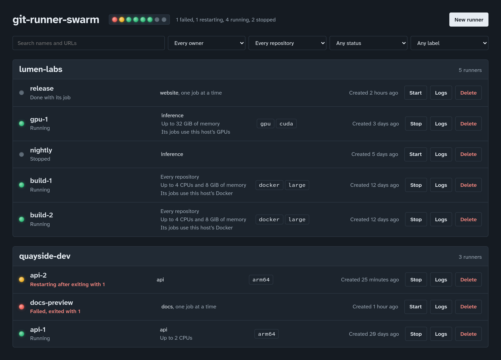

# git-runner-swarm

A web panel for self-hosted GitHub Actions runners. Each runner is a
Docker container running GitHub's official runner image: create runners
from a registration token, see at a glance which are running and which
are failing, read their logs, and start, stop or delete them.



## Getting started

On a Linux host with Docker, amd64 or arm64:

```sh
docker run -d --name git-runner-swarm --restart unless-stopped \
  -p 127.0.0.1:8080:8080 \
  -v /var/run/docker.sock:/var/run/docker.sock \
  otsobide/git-runner-swarm
```

Or with Compose, in a `compose.yaml`, then `docker compose up -d`:

```yaml
services:
  panel:
    image: otsobide/git-runner-swarm:latest
    restart: unless-stopped
    ports:
      - "127.0.0.1:8080:8080"
    volumes:
      - /var/run/docker.sock:/var/run/docker.sock
```

Open <http://localhost:8080>. Then, for each runner:

1. On GitHub, open the repository's **Settings › Actions › Runners ›
   New self-hosted runner** (or the organization's), and copy the token
   from the `./config.sh --url … --token …` command shown there. It is
   valid for an hour.
2. In the panel, choose **New runner**, paste the repository's URL and
   the token, give the runner a name, and choose **Create runner**.
3. In a workflow, pick it with `runs-on: self-hosted`, or by its labels.

The panel pulls GitHub's runner image the first time it is needed, and
the runner registers with GitHub as its container starts.

## What it does

- **Creates runners** for a repository, or for every repository of an
  organization, with labels, taking job after job or a single job each.
- **Shows every runner**, grouped by organization or user, each with a
  status lamp: running, restarting, failed, stopped.
- **Shows each runner's logs**, kept current, so a runner that fails
  says why.
- **Limits** the CPU and memory each runner may use, and, only when
  asked, gives a runner's jobs the host's Docker to build images with,
  or the host's GPUs (AMD, Intel or NVIDIA) to render and compute on.
- **Stores nothing but Docker**: a runner is a container, with its
  definition in the container's labels. The panel can be stopped or
  upgraded while the runners carry on.

## Tags

- `latest`: the latest release.
- `X.Y`, such as `0.2`: the latest release of that minor version.
- `X.Y.Z`, such as `0.2.2`: one release, never moved.

Every tag is built for `linux/amd64` and `linux/arm64`. To upgrade:
`docker pull`, then recreate the container (`docker compose pull &&
docker compose up -d`). Runners keep running while the panel is
replaced.

## Configuration

Environment variables, each optional:

| Variable                   | Default                                 | What it is                                                     |
| -------------------------- | --------------------------------------- | -------------------------------------------------------------- |
| `GRS_GITHUB_IMAGE`         | `ghcr.io/actions/actions-runner:latest` | The image GitHub runners run: a pinned tag, a mirror, your own. |
| `GRS_STOP_TIMEOUT`         | `30`                                    | Seconds a runner is given to stop cleanly before it is killed. |
| `GRS_RUNNER_DOCKER_SOCKET` | `/var/run/docker.sock`                  | Docker's socket on the host, for runners given Docker.         |
| `GRS_RUNNER_GPUS`          | `/dev/dri`                              | The GPUs runners given the host's get: device paths, `nvidia`. |
| `GRS_LISTEN`               | `0.0.0.0:8080`                          | The address the panel listens on, in its container.            |
| `RUST_LOG`                 | `info`                                  | How much the panel logs.                                       |

Every setting, with recipes, is in the
[configuration guide](https://github.com/otsobide/git-runner-swarm/blob/main/docs/configuration.md).

## Before you expose it

Whoever can reach the panel controls the host's Docker, which is root on
the host, and the panel has no login yet. Publish its port on
`127.0.0.1` only, as above, and reach it through an SSH tunnel, or put
it behind a proxy that authenticates. The jobs of a runner given the
host's Docker are as much root on the host. See the
[security guide](https://github.com/otsobide/git-runner-swarm/blob/main/docs/security.md).

## More

- Source, issues and documentation:
  [github.com/otsobide/git-runner-swarm](https://github.com/otsobide/git-runner-swarm)
- [Usage guide](https://github.com/otsobide/git-runner-swarm/blob/main/docs/usage.md):
  creating and managing runners in depth, statuses, troubleshooting.
- [API](https://github.com/otsobide/git-runner-swarm/blob/main/docs/api.md):
  the JSON API the panel is built on, for scripts.
- [Changelog](https://github.com/otsobide/git-runner-swarm/blob/main/CHANGELOG.md)
