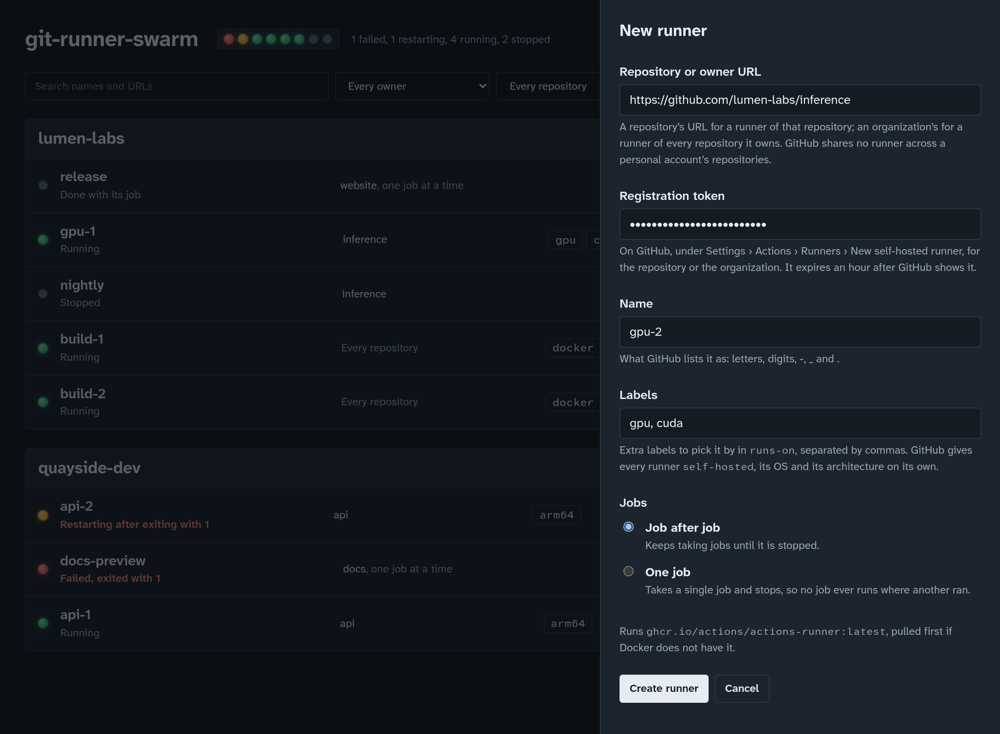
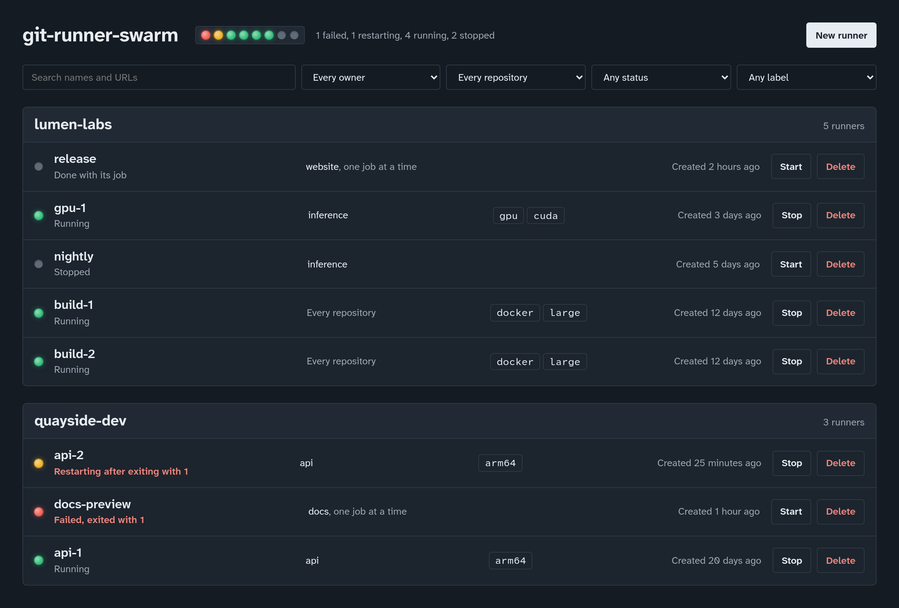
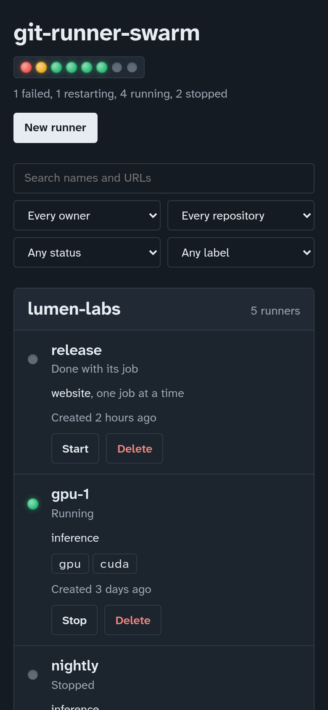

# Using git-runner-swarm

Everything about running the panel and managing runners with it. For a
quick start, see the [README](../README.md); for the settings, see
[configuration.md](configuration.md).

- [Running the panel](#running-the-panel)
- [Creating a runner](#creating-a-runner)
- [Using a runner in workflows](#using-a-runner-in-workflows)
- [Reading the panel](#reading-the-panel)
- [Finding runners](#finding-runners)
- [Stopping, starting and deleting](#stopping-starting-and-deleting)
- [Runners outlive the panel](#runners-outlive-the-panel)
- [Looking inside a runner](#looking-inside-a-runner)
- [Troubleshooting](#troubleshooting)
- [Removing everything](#removing-everything)

## Running the panel

The panel needs a Linux host with Docker, and is built from this
repository:

```sh
git clone https://github.com/otsobide/git-runner-swarm.git
cd git-runner-swarm
docker compose up -d
```

The first build takes a few minutes. Then open <http://localhost:8080>.

The compose file publishes the panel on `127.0.0.1` only, mounts the
host's Docker socket, and restarts the panel with Docker
(`restart: unless-stopped`). Anyone who can reach the panel controls the
host's Docker, so read [security.md](security.md) before making it
reachable from anywhere else.

Without Compose, the same thing is:

```sh
docker build -t git-runner-swarm .
docker run -d --name git-runner-swarm --restart unless-stopped \
  -p 127.0.0.1:8080:8080 \
  -v /var/run/docker.sock:/var/run/docker.sock \
  git-runner-swarm
```

To try the panel without touching Docker, run it with
`GRS_RUNTIME=memory`: runners are then kept in memory, nothing runs,
and everything is forgotten when the panel stops.

### Upgrading and stopping it

```sh
git pull
docker compose up -d --build   # upgrade
docker compose down            # stop it, and keep it from starting with Docker
```

Neither touches the runners: they are containers of their own, and keep
running while the panel is down. A new panel finds them again (see
[Runners outlive the panel](#runners-outlive-the-panel)).

## Creating a runner



Choose **New runner** and fill in the form:

**Repository or owner URL.** What the runner takes jobs from:

- a repository's URL, `https://github.com/owner/repository`, for a
  runner of that repository alone;
- an organization's URL, `https://github.com/organization`, for a
  runner of every repository of the organization (which the
  organization's settings can narrow to some repositories, with runner
  groups).

GitHub has no runners for a personal account as a whole: on a personal
account, a runner serves one repository. The URL may end in `/` or
`.git`, so a URL copied from the repository's page or from a clone
command works as it is.

**Registration token.** A one-time token GitHub issues to register a
runner with:

- for a repository: the repository's **Settings › Actions › Runners ›
  New self-hosted runner**;
- for an organization: the organization's **Settings › Actions ›
  Runners › New runner › New self-hosted runner**.

GitHub shows the token inside the `./config.sh --url … --token …` command
on that page; only the token is needed. It expires an hour after GitHub
shows it, but only the runner's first start needs it, so a runner keeps
working after its token expires. With the GitHub CLI, a token can be
had without the browser:

```sh
gh api -X POST repos/OWNER/REPOSITORY/actions/runners/registration-token --jq .token
gh api -X POST orgs/ORGANIZATION/actions/runners/registration-token --jq .token
```

**Name.** What GitHub lists the runner as: up to 64 letters, digits,
`-`, `_` and `.`. Two runners of one repository or organization cannot
share a name (ignoring case), since GitHub would let the second replace
the first: the panel refuses the second.

**Labels.** Extra labels to select the runner by in a workflow's
`runs-on`, separated by commas or spaces: `gpu, large`. Each is up to
100 letters, digits, `-`, `_` and `.`. GitHub gives every runner
`self-hosted`, its operating system (`Linux`) and its architecture
(`X64` or `ARM64`) on its own.

**Jobs.**

- **Job after job** (persistent): the runner keeps taking jobs until it
  is stopped, and Docker restarts it if it exits or the host reboots.
  What a job leaves in the container (files, installed tools) is still
  there for the next job.
- **One job** (ephemeral): the runner takes a single job and exits, so
  no job ever runs where another ran. GitHub removes the runner once its
  job is done: to take another job, create a new runner.

**Image.** The panel runs GitHub's official runner image,
`ghcr.io/actions/actions-runner:latest` unless configured otherwise
(`GRS_GITHUB_IMAGE`). When more images are configured, the form offers
a choice.

**Create runner** then:

1. pulls the image, if Docker does not have it (the first time takes a
   while: it is over 2 GB unpacked);
2. creates the runner's container, `git-runner-swarm-<id>`, and starts
   it;
3. the container registers the runner with GitHub, then waits for jobs.

The runner appears in the panel at once; it shows as **Idle** under the
repository's or organization's **Settings › Actions › Runners** a few
seconds later. If it never does, see
[Troubleshooting](#troubleshooting).

The same is available to scripts through the [API](api.md#post-apirunners).

## Using a runner in workflows

Select the runner in a job's `runs-on`, by `self-hosted` or by its
labels, all of which it must have:

```yaml
jobs:
  train:
    runs-on: [self-hosted, gpu]
    steps:
      - uses: actions/checkout@v7
      - run: ./train.sh
```

GitHub's image is deliberately small. It is Ubuntu with the runner, and
little else:

- `git`, `curl`, `jq`, `unzip` and `sudo` (without a password) are
  there;
- compilers (`gcc`, `make`), language runtimes, and everything else a
  GitHub-hosted runner comes with are not;
- the `docker` command is there, but no Docker engine: the panel does
  not give runners the host's Docker.

So jobs install what they need, with the `actions/setup-*` actions
(Node, Python, Go, Java, …) or `sudo apt-get install`. On a persistent
runner, what one job installs stays for the next.

## Reading the panel



At the top, a lamp per runner, worst first, and the counts in words:
the state of every runner at a glance. Below, one rack per owner (the
organization or user in the runner's URL), owners in alphabetical order,
each rack's runners newest first.

Each row is one runner: its lamp and status, what it serves (a
repository, or *Every repository* of the owner, and *one job at a time*
for an ephemeral runner), its labels, when it was created, and what can
be done with it.

| Lamp   | Status                              | What it means                                                                                     |
| ------ | ----------------------------------- | ------------------------------------------------------------------------------------------------- |
| green  | Running                             | The container runs: the runner is registered, or registering.                                     |
| amber, blinking | Restarting after exiting with *n* | The runner exited with code *n* and Docker is starting it again, over and over. Something is wrong. |
| red    | Failed, exited with *n*             | The runner exited with code *n* and will not be restarted.                                        |
| red    | Dead                                | Docker could not stop or remove the container cleanly.                                            |
| grey   | Stopped                             | A persistent runner, stopped from the panel (or by Docker).                                       |
| grey   | Done with its job                   | An ephemeral runner that took its one job and exited.                                             |
| grey   | Created, not started / Paused       | The container exists but does not run.                                                            |

The status is the container's, not GitHub's: a runner can run in its
container while GitHub shows it offline, for example while it is still
registering, or when it cannot reach GitHub.

The panel asks for the runners again every five seconds, so what a
runner does on its own (finish its job, fail) shows within a few
seconds, without reloading.

It follows the system's light or dark appearance, and works on a phone:



## Finding runners

Above the racks:

- **Search** finds runners whose name or URL contains the text;
- **Owner** keeps one owner's runners;
- **Repository** keeps one repository's runners, among the chosen owner's;
- **Status**: running, restarting, stopped or failed, and the rarer ones;
- **Label** keeps runners with one extra label (shown once any runner
  has one).

Filters combine: a runner is shown only when it matches all of them.
**Clear filters** shows every runner again. The lamps and counts at the
top always count every runner, filtered or not.

## Stopping, starting and deleting

**Stop** stops the runner's container. The runner is given
`GRS_STOP_TIMEOUT` seconds (30 by default) to stop cleanly, cancelling
the job it is running, before it is killed. GitHub shows it offline
until it is started again. Docker does not restart a stopped runner,
not even after a reboot.

**Start** starts a stopped runner's container again. It needs no new
token: the runner's registration is kept in its container.

**Delete**, after a confirmation in the row, removes the runner's
container (stopping it first) and everything in it. GitHub keeps
listing the runner, offline, until it drops it on its own (a day for an
ephemeral runner, two weeks for another), or until it is removed by
hand:

- in the repository's or organization's **Settings › Actions ›
  Runners**, from the runner's menu; or
- with the GitHub CLI:

  ```sh
  gh api repos/OWNER/REPOSITORY/actions/runners --jq '.runners[] | "\(.id) \(.name) \(.status)"'
  gh api -X DELETE repos/OWNER/REPOSITORY/actions/runners/RUNNER_ID
  ```

  (`orgs/ORGANIZATION/…` for an organization's runner).

A runner created again under the same name takes the offline one's
place, so removing it first is not necessary.

A runner's URL, name, labels and kind cannot be changed: delete it and
create it again, with a new token.

## Runners outlive the panel

Each runner is a container of its own, with everything the panel knows
of it in the container's labels. So:

- stopping, upgrading or deleting the panel leaves runners running;
- a new panel, on the same Docker, finds every runner again;
- after a reboot, Docker starts persistent runners again (but not the
  ones that were stopped), and the panel with them.

## Looking inside a runner

A runner's container is `git-runner-swarm-<id>`, its id being the one
the API gives (or the end of its container's name in `docker ps`):

```sh
# Every runner's container.
docker ps -a --filter label=git-runner-swarm.managed=true

# What a runner says: registering, connecting, the jobs it runs.
docker logs -f git-runner-swarm-<id>

# Everything the panel stores about a runner.
docker inspect --format '{{json .Config.Labels}}' git-runner-swarm-<id>
```

The panel's own logs:

```sh
docker compose logs -f panel
```

## Troubleshooting

**A new runner shows *Restarting after exiting with 1*, and never
appears on GitHub.** It could not register. Its logs (`docker logs
git-runner-swarm-<id>`) say why; most often:

- the token expired (an hour after GitHub showed it);
- the token is for another repository or organization than the URL;
- the URL is a personal account's, which GitHub has no runners for.

Delete the runner, get a fresh token, and create it again.

**A runner shows *Running* but GitHub shows it *Offline*.** It may
still be registering (give it a few seconds), or it cannot reach
GitHub: check its logs, and the host's network.

**Creating a runner fails with *already serves*.** Another runner in the
panel has that name for that URL, ignoring case. Choose another name, or
delete the other runner first.

**Creating a runner fails with *could not be pulled*.** Docker could not
pull the image: check the host can reach the registry (`docker pull
ghcr.io/actions/actions-runner:latest`), and the image name if
`GRS_GITHUB_IMAGE` is set.

**The panel shows *The panel's server cannot be reached*.** The panel's
container stopped. `docker compose ps` and `docker compose logs panel`
say why.

**The panel exits at start, saying Docker cannot be reached.** The
Docker socket is not mounted into its container, or `DOCKER_HOST`
points somewhere Docker is not. Check the `volumes` of
`compose.yaml`.

**The panel exits at start, naming a variable.** That variable is set to
something it cannot use; the message says what it expects. See
[configuration.md](configuration.md).

## Removing everything

1. Delete every runner from the panel (or, from a shell:
   `docker rm -f $(docker ps -aq --filter label=git-runner-swarm.managed=true)`).
2. Remove their registrations on GitHub, if you would rather not wait
   for GitHub to drop them ([see above](#stopping-starting-and-deleting)).
3. Stop the panel and remove its image:
   `docker compose down --rmi all`.
4. Optionally, remove the runner image: `docker rmi ghcr.io/actions/actions-runner:latest`.
